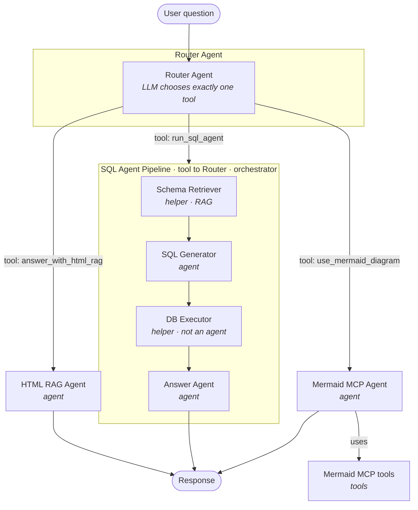

# Agents — communication & flow

Who calls whom, and what is an **agent** vs a **tool** / **helper**.

## Overview

## Roles

| Module | Kind | Called by | Calls |
|--------|------|-----------|--------|
| **Router Agent** (`router-agent.js`) | **Agent** | App / API | Chooses one of 3 tools |
| **HTML RAG Agent** (`html-rag-agent.js`) | **Agent** (exposed as tool `answer_with_html_rag`) | Router | HTML vector store + LLM |
| **SQL Agent Pipeline** (`sql-agent-pipeline.js`) | **Tool** to Router (orchestrator, no own LLM) | Router as `run_sql_agent` | Schema → SQL Gen → DB → Answer |
| **Mermaid MCP Agent** (`mermaid-mcp-agent.js`) | **Agent** (exposed as tool `use_mermaid_diagram`) | Router | Mermaid MCP tools via AgentExecutor |
| **Schema Retriever** (`schema-retriever.js`) | **Helper** (RAG, no LLM) | SQL Pipeline | Schema vector store |
| **SQL Generator** (`sql-generator.js`) | **Agent** | SQL Pipeline | LLM → SQL |
| **DB Executor** (`db-executor.js`) | **Helper** (not an agent) | SQL Pipeline | Postgres |
| **Answer Agent** (`answer-agent.js`) | **Agent** | SQL Pipeline | LLM → natural-language answer |

## Call chain (simplified)

1. **Router Agent** uses LangChain `createAgent` with three tools and lets the LLM pick one:
   - `answer_with_html_rag` → **HTML RAG Agent**
   - `run_sql_agent` → **SQL Agent Pipeline**
   - `use_mermaid_diagram` → **Mermaid MCP Agent**
2. If the SQL path is chosen, the pipeline runs in order:
   - Schema Retriever → SQL Generator → DB Executor → Answer Agent
3. If the Mermaid path is chosen, the Mermaid agent connects to MCP and may call one or more **MCP tools** before returning.
