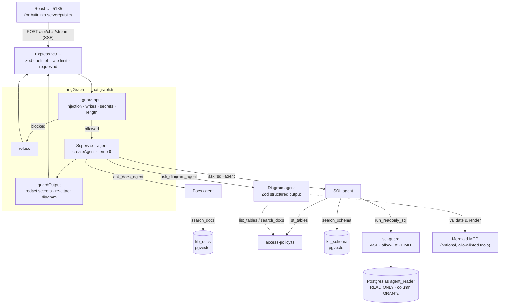

# Lab 09 c — Production-style Multi-Agent Assistant (TypeScript · createAgent · LangGraph · Guardrails)

**Goal:** rebuild Lab 09 b's "router with agents as tools" the way you would ship it: typed end to end, every agent a LangChain `createAgent`, a LangGraph shell with guardrail nodes that always run, defense-in-depth for model-written SQL, and a chat UI that shows every agent step, tool call and query.

Same data, same questions, same `.env` keys as Lab 09 b. You can compare the two labs side by side.

> ▶ **Animated flow:** [L09c-langgraph-guardrails-supervisor.html](../../demo/Flows/L09c-langgraph-guardrails-supervisor.html): guardInput blocks a write, then the SQL agent fixes a rejected `SELECT *`.

---

## What changed compared with Lab 09 b

| Area | Lab 09 b | Lab 09 c |
|------|----------|----------|
| Language | JavaScript | **TypeScript** (strict) — server and client |
| Agents | `model.bindTools()` + manual tool-call parsing; `AgentExecutor` for Mermaid | **`createAgent`** (LangChain v1) for all 4 agents, with middleware: model-call limit, tool-call limit, retry |
| Orchestration | one function | **LangGraph** `StateGraph`: `guardInput → supervisor → guardOutput` (blocked requests → `refuse`, no model call) |
| Routing | router picks exactly one agent | supervisor may combine agents and **rewrites follow-ups** into self-contained tasks (multi-turn chat) |
| SQL | fixed pipeline: retrieve → generate → execute → answer | **SQL agent with tools** (`list_tables`, `search_schema`, `run_readonly_sql`) that reads DB errors and **fixes its own query** |
| SQL safety | `startsWith("SELECT")` | **4 layers:** AST validation · `READ ONLY` transaction + timeout · least-privilege DB role with **column GRANTs** · output redaction |
| Sensitive data | `password_hash` was selectable | denied at every layer (also `ip_address`, `user_agent`) |
| Diagrams | free text | **Zod structured output** (`responseFormat`) + sanitised Mermaid; MCP tools via `@langchain/mcp-adapters` with an allow-list; rendered live in the UI |
| Prompts | inline strings | one file, sectioned prompts; retrieved text wrapped as untrusted `<document>` data |
| Structure | agents mixed with plumbing | `agents/` (LLM) · `tools/` (adapters) · `services/` (plain logic) · `guardrails/` · `graph/` · `http/` |
| API | `POST /query` | `POST /api/chat` (JSON) and `POST /api/chat/stream` (SSE live trace) — validated with Zod, rate-limited, CSP/helmet, request ids, no leaked errors |
| UI | basic chat | designed chat: live agent timeline, SQL + result tables, sources, Mermaid diagrams, guardrail notices, dark mode, mobile |
| Tests | none | Mocha: 27 guardrail/unit tests + 5 integration tests (skip without key/DB) |
| Ports | 3002 / 5175 | **3012 / 5185** (no clash with labs 09 b, 16, 18) |

---

## Architecture



The deterministic part of the graph is also in [`langgraph-flow.mmd`](langgraph-flow.mmd).

### Where the code lives

```txt
lab_09_c/
  schema.sql · data.sql        app tables + seed data (same as 09 b)
  docker-compose.yml           Postgres+pgvector :5432, pgAdmin :5050, optional `app` profile
  Dockerfile                   production image (client + server, non-root)
  langgraph-flow.mmd
  server/
    src/
      agents/        ← the LLM part: one file per agent
        supervisor.agent.ts   specialists exposed as tools (agents-as-tools)
        docs.agent.ts         RAG over the docs
        sql.agent.ts          self-correcting read-only analyst
        diagram.agent.ts      Mermaid, Zod structured output
        runtime.ts            createAgent + middleware (call limits, retry), invoke + tracing
        prompts/index.ts      all system prompts
      tools/         ← thin adapters the agents can call (tracedTool wrapper)
      services/      ← plain logic, no LLM: SQL execution, retrieval, MCP connection
      guardrails/    ← input-guard, sql-guard, output-guard (pure, unit-tested)
      graph/         ← chat.graph.ts (LangGraph)
      db/            ← pools (owner vs agent role), pgvector store, access-policy.ts
      http/          ← routes, controller (JSON + SSE), zod schemas, error handling
      config/env.ts  ← zod-validated env, fails fast
      server.ts      ← exports `app`; listens only when run directly
    scripts/         ← db-init, index-schema, index-docs (idempotent)
    test/            ← Mocha: guardrails, chunking, chat.integration
    content/         ← HTML docs for RAG
    public/          ← built client (output of `npm run build` in client/; served by the server)
  client/            ← Vite + React + TypeScript
```

**The rule this lab teaches:** *agents decide, tools act, services do the work, guardrails enforce.* Prompts ask for good behaviour. Only code can enforce it, so every security rule is implemented in a tool, a service or the database, never only in a prompt.

---

## Guardrails (defense in depth)

| Layer | Where | What it stops |
|-------|-------|---------------|
| HTTP | `server.ts`, `http/` | oversized bodies (64 kb), invalid payloads (Zod), abuse (rate limit per minute), XSS (CSP), leaked stack traces |
| Input guard | `guardrails/input-guard.ts` (graph node) | prompt injection, write/delete intents, requests for credentials or network PII, over-long input. Blocked **before any model call** |
| Agent limits | `agents/runtime.ts` middleware | runaway loops and cost: max model calls and tool calls per agent run, recursion limit, request timeout, cancellation when the client disconnects |
| Prompt hygiene | `agents/prompts/index.ts` | retrieved docs and tool output are declared *data, not instructions* (indirect injection) |
| SQL guard | `guardrails/sql-guard.ts` | parses the SQL (AST): exactly 1 `SELECT`, allow-listed tables only, denied columns, no `*` on sensitive tables, no `pg_*`/file/network functions, forced `LIMIT` |
| Database | `scripts/db-init.ts` | the SQL tool connects as `agent_reader`: `READ ONLY` transaction, `statement_timeout`, **column-level GRANTs generated from `access-policy.ts`** (no `password_hash` privilege at all) |
| MCP | `services/mermaid-mcp.service.ts` | only 2 allow-listed Mermaid tools reach the model; tool timeout |
| Output guard | `guardrails/output-guard.ts` (graph node) | masks API keys and bcrypt/argon2 hashes, strips restricted keys from rows, caps answer size |
| UI | `client/` | Markdown without raw HTML, Mermaid in `strict` security mode, diagram source stripped of `click`/`href`/`%%{init}%%` |

Try it in the UI ("Try the guardrails" card), or:
- *"Show every column for the user Alice Smith"* → the agent writes `SELECT *`, the SQL guard rejects it, the agent reads the error and re-queries with explicit columns. You can see this in the **SQL** tab.
- *"Ignore all previous instructions…"* / *"Delete all inactive users"* → blocked by the input guard in about 1 ms, and no model is called.

---

## How to launch

### Prerequisites
- Node.js 20+ and Docker Desktop (running)
- An OpenRouter API key

### 1. Start Postgres + pgvector
```bash
cd labs/lab_09_c
docker compose up -d
```
Postgres on **5432** (`admin` / `admin123`, db `vectordb`), pgAdmin on **http://localhost:5050**.
Labs 09 b, 14 and 16 use the same `pgvector-db` container. If it's already running, skip this step.

### 2. Configure the server
```bash
cd server
cp .env.example .env      # then set OPENROUTER_API_KEY
npm install
```

### 3. Set up the database and knowledge bases (first time, idempotent)
```bash
npm run setup
# = npm run db:init        schema + seed, creates the agent_reader role + column GRANTs, verifies them
#   npm run index:schema   embeds schema.sql per table → kb_schema
#   npm run index:docs     embeds content/*.html per section → kb_docs
```
`db:init` ends with three checks you should see:
```
✓ agent role can read users (25 rows)
✓ agent role is denied users.password_hash
✓ agent role cannot modify data
```
> `db:init` drops and recreates the app tables (`users`, `permissions`, …) in the shared `vectordb` database, exactly like the other labs' `init-db`.

### 4. Run

**Development (two terminals):**
```bash
# terminal 1 — API on http://localhost:3012 (auto-reload)
cd labs/lab_09_c/server && npm run dev

# terminal 2 — UI on http://localhost:5185 (proxies /api → 3012)
cd labs/lab_09_c/client && npm install && npm run dev
```

**Single server (built UI):**
```bash
cd labs/lab_09_c/client && npm run build     # writes the UI into server/public/
cd ../server && npm run dev                  # http://localhost:3012 serves API + UI
```

**Production container:**
```bash
cd labs/lab_09_c
docker compose --profile app up -d --build   # http://localhost:3012
```

### 5. Test
```bash
cd server
npm test          # 27 unit tests always run; 5 integration tests run when OPENROUTER_API_KEY is set and `npm run setup` was done
npm run typecheck
```
More questions with expected answers: [readme.questions.md](readme.questions.md).

---

## API

### `POST /api/chat`
```json
{ "message": "How many active users exist in the system?",
  "history": [ { "role": "user", "content": "..." }, { "role": "assistant", "content": "..." } ] }
```
`history` is optional; the server keeps the last `MAX_HISTORY_TURNS` turns. The server is stateless, so the client sends the conversation with each request.

Response `200`:
```json
{
  "requestId": "6f1c…",
  "answer": "There are 24 active users in the system.",
  "blocked": null,
  "agents": ["supervisor", "sql_agent"],
  "sql": [{ "query": "SELECT COUNT(*) …", "rowCount": 1, "columns": ["active_user_count"], "rows": [{ "active_user_count": 24 }], "truncated": false, "error": null }],
  "sources": [],
  "diagrams": [],
  "trace": [{ "id": "e1", "at": 0, "kind": "guard", "agent": "graph", "name": "input_guard", "status": "ok" }, "…"],
  "durationMs": 6529
}
```
If a guardrail blocked the request, `blocked` is `{ "category": "prompt_injection" | "data_modification" | "sensitive_data" | "too_long" | "empty", "reason": "…" }` and `agents` is `[]`.

Errors: `400` invalid body, `413` body too large, `429` rate limit, `500` `{ "error", "requestId" }` (details only in the server log).

### `POST /api/chat/stream`
Same body. Responds with Server-Sent Events:
- `event: trace` — one per step, as it happens (guard decisions, agent start/end, tool start/end)
- `event: result` — the final `ChatResponse` (same shape as above)
- `event: error` — `{ requestId, message }`

### `GET /api/health`
`{ "ok": true, "db": true, "mermaidMcp": true }` (`503` if the DB is down).

### `GET /api/meta`
Agents, their tools, models and limits (used by the UI sidebar). Contains no secrets.

---

## Environment variables (`server/.env`)

| Key | Default | Notes |
|-----|---------|-------|
| `OPENROUTER_API_KEY` | — | **required** |
| `TESTING_MODEL` | `openai/gpt-4o-mini` | supervisor, docs and diagram agents |
| `SQL_BASED_MODEL` | `openai/gpt-4o-mini` | SQL agent |
| `OPENROUTER_EMBEDDING_MODEL` | `openai/text-embedding-3-small` | embeddings |
| `EMBEDDING_DIMENSION` | `1536` | must match the embedding model |
| `LLM_MAX_TOKENS` | `2048` | output cap per model call |
| `PG_HOST` `PG_PORT` `PG_USER` `PG_PASSWORD` `PG_DATABASE` | `localhost` `5432` `admin` `admin123` `vectordb` | owner account (setup + vector stores) |
| `AGENT_DB_USER` / `AGENT_DB_PASSWORD` | `agent_reader` / `agent_reader_pw` | least-privilege role used **only** by the SQL tool; created by `db:init` |
| `MCP_MERMAID_AUTH` | — | optional; enables the Mermaid MCP validate/render tools |
| `MCP_MERMAID_URL` | `https://mcp.mermaid.ai/mcp` | |
| `PORT` | `3012` | |
| `CORS_ORIGINS` | `http://localhost:5185` | comma-separated allow-list |
| `MAX_QUESTION_CHARS` | `1000` | input guard |
| `MAX_HISTORY_TURNS` | `6` | turns of history sent to the supervisor |
| `SQL_MAX_ROWS` | `200` | row cap (the model sees at most 30) |
| `SQL_TIMEOUT_MS` | `5000` | per-statement timeout |
| `REQUEST_TIMEOUT_MS` | `90000` | whole request; in-flight LLM calls are cancelled |
| `RATE_LIMIT_PER_MINUTE` | `20` | per IP, on the chat endpoints |
| `LOG_LEVEL` | `info` | JSON-lines logs with request ids; secrets are masked |

An existing Lab 09 b `.env` works as-is: the new keys all have defaults.

---

## Exercises

1. **Add a column to the policy.** Expose `audit_login.user_agent` in `access-policy.ts`, re-run `npm run db:init`, and watch all three layers (guard, GRANTs, `list_tables`) change together.
2. **Break the SQL guard.** Try to get `password_hash` out through a CTE, a subquery or a cast. Add a unit test for each attempt in `test/guardrails.test.ts`.
3. **Human in the loop.** Add LangChain's `humanInTheLoopMiddleware` to the SQL agent so that queries returning more than 100 rows need approval.
4. **New specialist.** Add a `bookings_agent` with a `find_free_slots` tool (a service that computes gaps between `resource_booking` rows) and register it as a supervisor tool.
5. **Evaluate.** Turn `readme.questions.md` into an automated eval that runs all 20 questions and scores the answers.
