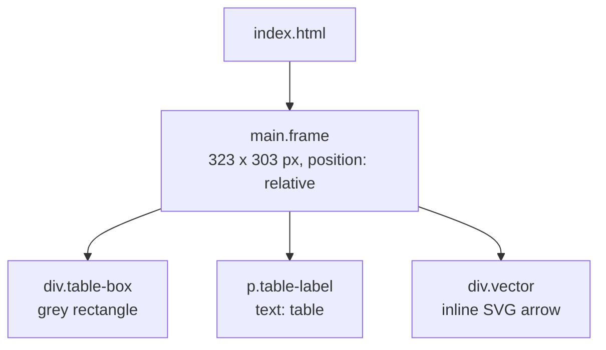

# Prompt

## How it works

Lab 1 is a static wireframe exported from Figma. **It has no agent, LLM call, or runtime logic**, so the diagram below shows the page structure instead. To view it, open `index.html` in a browser; there is nothing to install.

Each element is absolutely positioned using the Figma coordinates, and each `data-node-id` attribute points back to its Figma layer. `index.js` is an empty placeholder.
