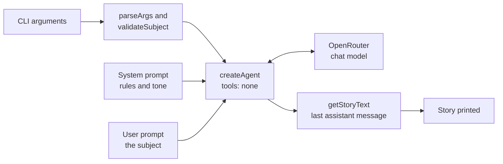

# Kids story agent

Simple LangChain agent that writes short, happy stories for kids (max 5 sentences) using OpenRouter.

## Setup

```bash
cd lab_2
npm install
cp .env.example .env
# Edit .env and set OPENROUTER_API_KEY
```

## Run

```bash
npm run agent -- "a friendly dragon"
```

Optional system prompt override for one run:

```bash
npm run agent -- --system "You are a silly pirate storyteller for toddlers." "treasure hunt"
```

Or set `SYSTEM_PROMPT` in `.env` for all runs.

## Environment

| Variable | Description |
|----------|-------------|
| `OPENROUTER_API_KEY` | Required — from [OpenRouter keys](https://openrouter.ai/keys) |
| `OPENROUTER_MODEL` | `openai/gpt-5.5` (default) or `openai/gpt-5.4` |
| `SYSTEM_PROMPT` | Optional default system instructions |

Story subject is limited to **80 characters**.

## How it works

This is the simplest form of agent: **a prompt and a model, with no tools**. `tools: []` means the agent makes one model call and returns.

### Story agent



| Concept | Where to look in `agent.js` |
| --- | --- |
| System prompt: rules for every run | `DEFAULT_SYSTEM_PROMPT` |
| User prompt: this run's request | `userPrompt` in `main()` |
| Validation before spending tokens | `validateSubject()` |
| Reading the answer from the conversation | `getStoryText()` |
