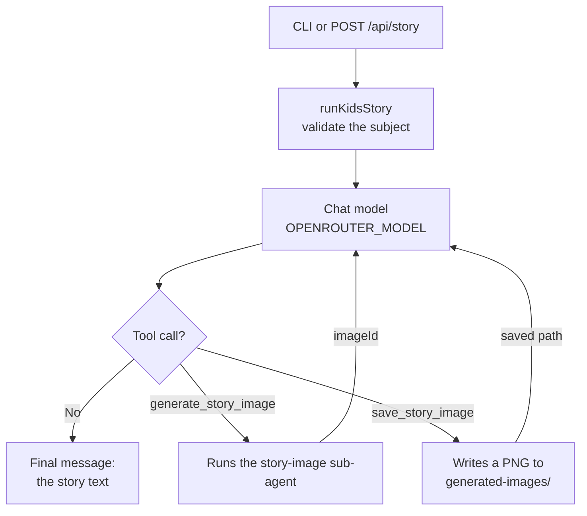
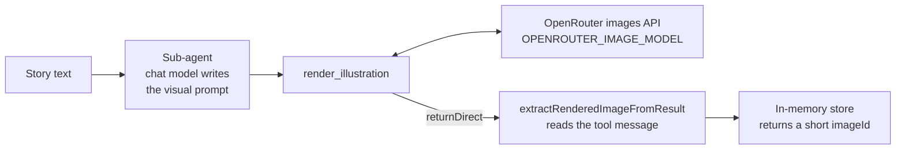
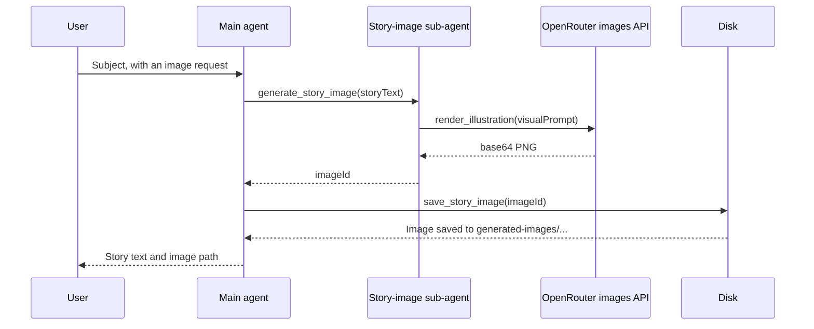

# Kids story agent

LangChain agent that writes short, happy stories for kids (max 5 sentences) using OpenRouter.

Includes:

- CLI agent
- Express HTTP API
- React client (calls the API)
- Docker Compose (API + client)

## Docker Compose (recommended for any machine)

On a fresh machine you only need Docker, Git, and an OpenRouter API key.

```bash
git clone <YOUR_REPO_URL>
cd 45600_2_Agentic_AI_Development/lab_2_1

cp .env.example .env
# Edit .env and set OPENROUTER_API_KEY

docker compose up --build
```

Then open:

- Client UI: http://localhost:3000
- API health: http://localhost:3001/api/health

Stop:

```bash
docker compose down
```

Rebuild after code changes:

```bash
docker compose up --build
```

Compose builds both images, starts the API on port **3001**, and the client on port **3000**. The client proxies `/api` and `/generated-images` to the API container, so the browser only needs port 3000.

## Local setup (without Docker)

```bash
cd lab_2_1
npm install
cp .env.example .env
# Edit .env and set OPENROUTER_API_KEY

# Terminal 1 — API
npm run dev

# Terminal 2 — client
cd client
npm install
npm run dev
```

- API: http://localhost:3001
- Client (Vite): http://localhost:5173 (proxies API calls)

## CLI

```bash
npm run agent -- "a friendly dragon"
npm run agent -- --image "a friendly dragon"
npm run agent -- --debug "a friendly dragon"
```

## HTTP API

`POST /api/story`

```json
{
  "subject": "a friendly dragon",
  "generateImage": false
}
```

Response:

```json
{
  "success": true,
  "story": "...",
  "imagePath": null,
  "imageUrl": null,
  "modelId": "openai/gpt-5.5"
}
```

`GET /api/health` — liveness check.

Generated images are served from `/generated-images/...`.

## Environment

| Variable                 | Description                                                         |
| ------------------------ | ------------------------------------------------------------------- |
| `OPENROUTER_API_KEY`     | Required — from [OpenRouter keys](https://openrouter.ai/keys)       |
| `OPENROUTER_MODEL`       | `openai/gpt-5.5` (default) or `openai/gpt-5.4`                      |
| `OPENROUTER_IMAGE_MODEL` | `openai/gpt-image-1-mini` (default)                                 |
| `SYSTEM_PROMPT`          | Optional default system instructions                                |
| `PORT`                   | API port (default `3001`)                                           |

Story subject is limited to **80 characters**.

## Ex_1

- Add a Tool to save each story in folder - stories_history
- Only If the user request explicitly to save the story.
- (no AI in the tool)

## Ex_2

- Support translation tool - if the user request to translate the story.

## Model reasoning

Reasoning-capable models (e.g. `openai/gpt-5.5`) can return chain-of-thought tokens. The agent requests a readable summary via `modelKwargs.reasoning` (`effort: "medium"`, `summary: "detailed"`) and the CLI prints it with `printReasoning()` in `agent.js`.

If the model returns no reasoning tokens, the box is skipped and only the story is printed. With `openai/gpt-5.5`, OpenRouter may return encrypted reasoning only — use `openai/gpt-5.4` for consistent readable summaries.

## How it works

Lab 2.1 adds **tools** and a **sub-agent**. With tools, the agent runs as a loop: the model asks for a tool, the code runs it, the result goes back to the model, and this repeats until the model replies with text.

The CLI (`agent.js`) and the API (`src/server.ts`) both call `runKidsStory()` in `src/story-agent.js`.

### Main story agent

The system prompt tells the model to use tools only when an image is requested. `--image` or `generateImage: true` adds that request to the user prompt.



### Story-image sub-agent

This agent writes the visual prompt, and its tool draws the image. `returnDirect: true` stops the loop as soon as the tool returns, so the large base64 image never goes back to an LLM.



### Full `--image` run

The agents exchange a short `imageId` rather than the image, which keeps LLM requests small.


