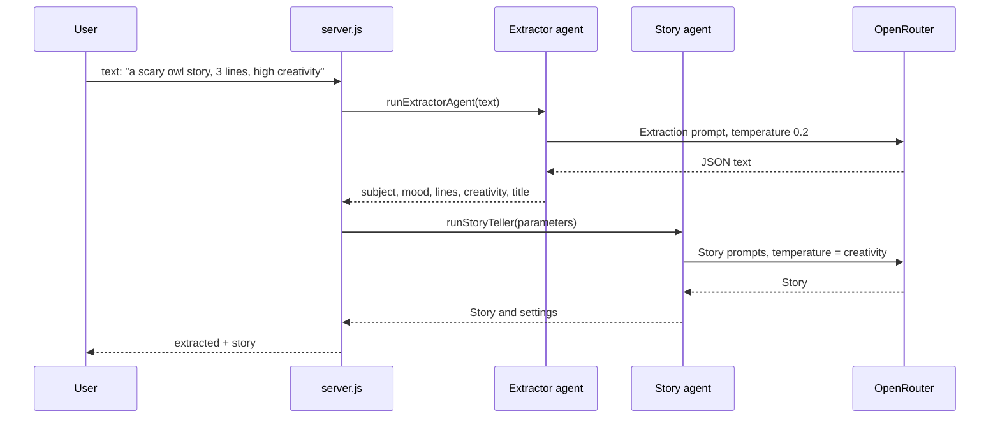
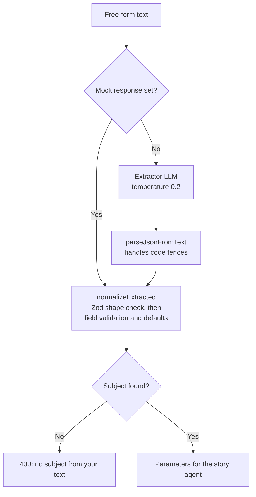
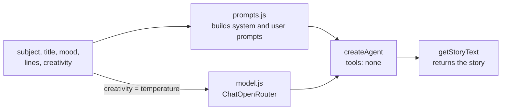

# Lab 3 — Kids story agent

LangChain agent that writes short kids stories (happy or scary) using OpenRouter.

## Setup

```bash
cd lab_3
npm install
cp .env.example .env
# Edit .env and set OPENROUTER_API_KEY
```

## Run

```bash
npm run agent -- "a friendly dragon"
```

Customize title, mood, and length:

```bash
npm run agent -- --title "The Brave Dragon" --mood happy --lines 5 "a friendly dragon"
npm run agent -- --title "Whispers in the Attic" --mood scary --lines 8 "an old house at night"
```

| Option                | Description                             |
| --------------------- | --------------------------------------- |
| `--title "<text>"`    | Story title (printed on the first line) |
| `--mood happy\|scary` | Tone (default: `happy`)                 |
| `--lines <n>`         | Max lines, 1–10 (default: `5`)          |

Override prompts for a single run:

```bash
npm run agent -- --system "You are a silly pirate storyteller for toddlers." "treasure hunt"

npm run agent -- --user "Tell a cheerful bedtime story about: {subject}" "sleepy owl"
```

Or set `SYSTEM_PROMPT` and `USER_PROMPT` in `.env` for all runs.

## Environment

| Variable             | Description                                                   |
| -------------------- | ------------------------------------------------------------- |
| `OPENROUTER_API_KEY` | Required — from [OpenRouter keys](https://openrouter.ai/keys) |
| `OPENROUTER_MODEL`   | LangChain model string, default `openrouter:gpt-5.4`          |
| `SYSTEM_PROMPT`      | Optional default system instructions                          |
| `USER_PROMPT`        | Optional user prompt template; use `{subject}` as placeholder |

Story subject is limited to **50 characters**.

# Prompt_1

Create folder lab_3

Using the langchain library with node.js

create an agent - that receive a story subject, the agent will create - output a short story, happy story for kids.

the input will include only subejct maximum with 50 characters

the output will be maximum 5 sentences

Use node.js project, support command line to lunch the agent from the packge.json with the relevant input

create the agent using the following example:
const agent = createAgent({ model: "openrouter:gpt-5.4", tools });

create .env variable for openrouter api key, i will use the openrouter service to import the relevant models.

support system and user prompts.

# Prompt_2

@lab_3
Add an extra support for the agent:
the agent should receive a few more paramters

1. story title
2. scary/happy story - instruct the model to write the apropriate story according to this paramter
3. the length of the story - number ( default 5 lines )
   limit the story to the number of lines, maximum 10 lines.

# How it works

Lab 4 builds on lab 3 by adding a **two-agent pipeline**. The user writes one free-text request, an extractor agent turns it into structured parameters, and the story agent writes from those parameters. Neither agent uses tools. Plain code in `server.js` connects them.

> This folder has no `.env.example`. Create `.env` by hand with at least `OPENROUTER_API_KEY`.

## Full pipeline: `POST /api/story/chat`



## Extractor agent

The LLM interprets the language. Code then checks everything it returns, because model output can't be trusted to be valid.



Fields the user doesn't mention come back as `null` and get defaults in code: mood `happy`, 5 lines, creativity `0.5`.

## Story agent

This is the lab 3 agent with one addition: `creativity` sets the model temperature.



Notes:

- `POST /api/story` doesn't accept `creativity`, so that route always uses `0.5`. Only `/api/story/chat` can change it.
- To test the pipeline without calling the extractor LLM, send `mockExtractor` in the request body or set `EXTRACTOR_MOCK_RESPONSE`. The story agent still calls the real model.
- `OPENROUTER_MODEL` must keep the `openrouter:` prefix (for example `openrouter:gpt-5.4`).
