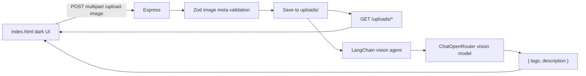

# lab_6_1 — Image Vision Agent (Express + LangChain)

## Goal

Build a self-contained lab under [`lab_6_1/`](lab_6_1/) where a native dark-theme client uploads one PNG/JPEG (≤1MB), Express saves and statically serves it, and a LangChain agent (OpenRouter vision model) returns structured JSON:

```json
{ "tags": ["string", "..."], "description": "short description" }
```

UI shows **tags/keywords** immediately and an **Explain** control that reveals `description` (same response; no second API call).

## Architecture



Reuse course patterns:

- Express + static + colocated native client → [`lab_4/server.js`](lab_4/server.js) / [`lab_4/index.html`](lab_4/index.html)
- Image disk persist + static mount → [`lab_2_1/utils/save-story-image.util.js`](lab_2_1/utils/save-story-image.util.js), [`lab_2_1/src/server.ts`](lab_2_1/src/server.ts)
- Vision as base64 data URL → [`lab_7_RAG/lib/vision.js`](lab_7_RAG/lib/vision.js)
- LangChain + `@langchain/openrouter` + Zod → [`lab_6/src/agents/flightPlannerAgent.ts`](lab_6/src/agents/flightPlannerAgent.ts)

Stack choice: **JavaScript ESM** (lab_4 style) with a **lab_6-like folder layout** (`src/agents`, `src/schemas`, `src/prompts`, `src/lib`). Add **multer** (new to the course) for multipart uploads.

## Folder structure

```
lab_6_1/
├── .env.example
├── .gitignore
├── package.json
├── readme.md
├── server.js                 # Express entry
├── index.html                # Native client
├── public/
│   ├── css/styles.css        # Dark theme
│   └── js/app.js             # Upload + render tags/explain
├── uploads/                  # Saved images (+ .gitkeep)
└── src/
    ├── agents/imageVisionAgent.js
    ├── schemas/imageUploadSchema.js
    ├── schemas/visionResultSchema.js
    ├── prompts/visionPrompt.js
    ├── lib/vision.js           # path → data URL
    └── lib/saveUploadedImage.js
```

## Backend

### Dependencies (`package.json`)

- `express`, `cors`, `dotenv`, `multer`, `zod`
- `@langchain/openrouter`, `@langchain/core`, `langchain`
- Scripts: `"dev": "node --watch server.js"`, `"start": "node server.js"`

### Env (`.env.example`)

```
OPENROUTER_API_KEY=sk-or-v1-...
OPENROUTER_VISION_MODEL=openai/gpt-4o
PORT=3000
```

### Zod validation ([`src/schemas/imageUploadSchema.js`](lab_6_1/src/schemas/imageUploadSchema.js))

After multer, validate the uploaded file object (not raw binary):

- `mimetype` ∈ `image/png` | `image/jpeg`
- `size` ≤ `1_048_576`
- `originalname` / `filename` non-empty strings

Throw a typed validation error → HTTP `400` with `{ error, details }`.

Agent output schema ([`src/schemas/visionResultSchema.js`](lab_6_1/src/schemas/visionResultSchema.js)):

```js
z.object({
  tags: z.array(z.string().min(1)).min(1).max(12),
  description: z.string().min(1).max(500),
});
```

### Express ([`server.js`](lab_6_1/server.js))

1. `cors()`, JSON body not required for upload
2. `express.static` for `public/` (css/js) and project root so `index.html` is served
3. `express.static("/uploads", uploadsDir)` so clients negotiate image URLs like `/uploads/<file>`
4. Multer disk storage → `uploads/` with unique filename (`Date.now()` + safe ext `.png`/`.jpg`)
5. **`POST /upload-image`**
   - Multer single field `image`
   - Zod-validate `req.file`
   - Build public URL `/uploads/<filename>`
   - Call vision agent with absolute file path
   - Respond:

```json
{
  "success": true,
  "imageUrl": "/uploads/....jpg",
  "tags": ["..."],
  "description": "..."
}
```

6. `GET /api/health` → `{ status: "ok" }`
7. On agent failure: `500` with message; optionally delete bad upload only if desired (default: keep file for debugging)

### Vision agent ([`src/agents/imageVisionAgent.js`](lab_6_1/src/agents/imageVisionAgent.js))

- Model: `ChatOpenRouter` with `process.env.OPENROUTER_VISION_MODEL` (default `openai/gpt-4o`)
- Convert saved file via [`src/lib/vision.js`](lab_6_1/src/lib/vision.js) (same idea as lab_7: MIME + base64 data URL)
- Use LangChain `createAgent` with:
  - `systemPrompt` from [`src/prompts/visionPrompt.js`](lab_6_1/src/prompts/visionPrompt.js) — instruct: analyze image; return only tags + short description
  - `responseFormat` / structured Zod schema = `visionResultSchema` (so the API always gets `{ tags, description }`)
  - No tools required (vision-only structured agent)
- Invoke with multimodal user content: text instruction + `{ type: "image_url", image_url: { url: dataUrl } }`
- Export `analyzeImage(filePath) → { tags, description }`

If `createAgent` multimodal + `responseFormat` proves awkward in practice during implementation, fall back to `model.withStructuredOutput(visionResultSchema).invoke([SystemMessage, HumanMessage])` while keeping the same public API and schemas.

## Client (native HTML/CSS/JS)

### UI ([`index.html`](lab_6_1/index.html) + [`public/css/styles.css`](lab_6_1/public/css/styles.css))

- Dark theme (near-black background, light text, one accent — not purple-default)
- Single composition: title, short subtitle, upload control, preview, results
- File input: `accept="image/png,image/jpeg"`
- Client-side guards before send: type png/jpeg, size ≤ 1MB; show inline error otherwise
- After success: show image preview from `imageUrl`, render tags as a keyword list
- **Explain** button/toggle reveals `description` (hidden by default)
- Loading and error states

### Logic ([`public/js/app.js`](lab_6_1/public/js/app.js))

- `FormData` + `fetch("POST /upload-image")` with field name `image`
- Parse JSON; paint tags; stash description for Explain
- No React/Vite; same-origin via Express static (lab_4 pattern)

## Implementation order (for the Cursor agent)

1. Create `lab_6_1/` scaffold: `package.json`, `.gitignore`, `.env.example`, `uploads/.gitkeep`, `readme.md`
2. Add Zod schemas + vision prompt + `vision.js` + save helper
3. Implement `imageVisionAgent.js`
4. Wire `server.js` (multer, static, `/upload-image`, health)
5. Build dark native client (HTML/CSS/JS) with 1MB/type checks + tags + Explain
6. Document run steps in `readme.md`; smoke-test with a small PNG/JPEG

## Acceptance criteria

- Folder `lab_6_1` exists and starts with `npm install` + `npm run dev`
- `POST /upload-image` rejects non-png/jpeg and files >1MB (client + server)
- Uploaded files appear under `uploads/` and are reachable at `/uploads/...`
- Response includes `tags` (array) and `description` (string) from the OpenRouter vision agent
- Dark UI shows tags and optionally reveals the explanation
- Requires `OPENROUTER_API_KEY` in `.env`

## Execution 
1. 1 command with concurrently to run the client and server together.

## Out of scope

- React/Vite client, DB, auth, image generation, RAG
- Separate `/explain` endpoint (description returns with upload; UI gates visibility)
