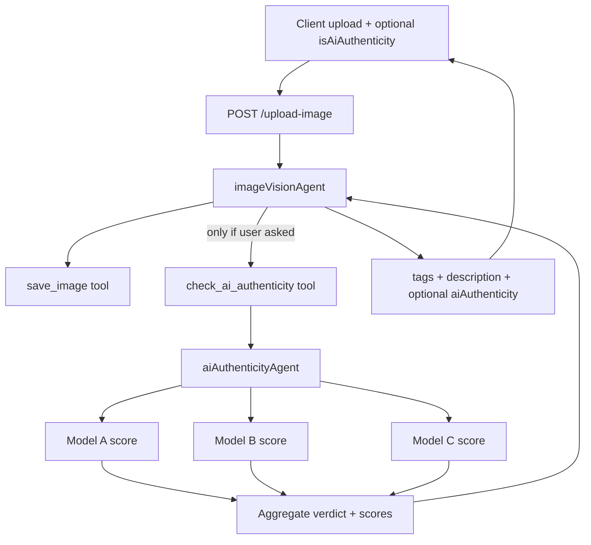

# lab_6_1 — AI authenticity analyze design

Self-contained design for extending the image vision lab with **opt-in AI-origin detection**. The main vision agent stays responsible for tags + description; authenticity runs only when the client asks, via an agent-as-tool that scores the image with multiple OpenRouter vision models.

> **This document is the plan.** Application code, schemas, and server wiring are out of scope for this pass. Use the file map and prompts below for a later implementation.

---

## 1. Goal

Extend `lab_6_1` so that:

1. Default path is unchanged: upload → `save_image` (optional) → `{ tags, description }`.
2. When the user opts in (UI checkbox and/or natural-language request), the main agent may call `check_ai_authenticity` once.
3. That tool wraps a dedicated **AI authenticity agent** that runs **3 OpenRouter vision models in parallel**, aggregates scores, and returns a structured `aiAuthenticity` object.
4. The main agent copies tool output into the response; it never invents authenticity scores.

---

## 2. Architecture



### Responsibility split

| Component | Owns |
| --- | --- |
| **Client** | Checkbox `isAiAuthenticity` (boolean, default `false`); optional free-text hints stay out of scope unless folded into the user instruction builder |
| **Express (`server.js`)** | Parse multipart + boolean; pass `isAiAuthenticity` into `analyzeImage` |
| **Main vision agent** | Tags, description, optional `save_image`, gate on `check_ai_authenticity` |
| **`check_ai_authenticity` tool** | Thin LangChain tool (same pattern as `saveImageTool.js`) that calls the authenticity agent |
| **Authenticity agent** | Parallel multi-model calls, confidence-weighted aggregate, final JSON |

---

## 3. When the tool runs

Authenticity is **opt-in only**.

### Client contract

- Form field / flag: `isAiAuthenticity` — boolean, **default `false`**.
- UI: checkbox labeled for “Check if this image was made by AI” (or equivalent).
- When unchecked / omitted → treat as `false`. Server must coerce string form values (`"true"` / `"false"` / `"on"`) to a real boolean and verify type before calling the agent.

### Main agent gate

The main system prompt and user instruction builder must enforce:

- Call `check_ai_authenticity` **at most once**.
- Call it **only** when `isAiAuthenticity === true` (or the user instruction explicitly states that the client requested AI authenticity).
- If the flag is false, **do not** call the tool and **do not** invent or include `aiAuthenticity` scores.

Natural-language fallback (optional later): if the user text contains phrases like “was this made by AI”, the client or server may set `isAiAuthenticity = true`. For v1, the checkbox boolean is the source of truth.

---

## 4. Multi-model scoring rules

### Per-model assessment

Each of the 3 vision models independently returns:

```json
{
  "model": "provider/model-id",
  "aiLikelihood": 0,
  "confidence": 0.0,
  "signals": ["..."],
  "reason": "..."
}
```

| Field | Rules |
| --- | --- |
| `aiLikelihood` | Integer **0–100**. Higher = more likely AI-generated or heavily AI-edited. |
| `confidence` | Float **0–1**. How sure the model is in its own score. |
| `signals` | Short strings citing visual cues (texture, lighting, edges, anatomy, etc.). No provenance invention. |
| `reason` | One short paragraph. Prefer “inconclusive” language when the image is too weak to judge. |

### Aggregation

1. Require **3 successful** model assessments (configurable models via env; see below).
2. Confidence-weighted average:

   \[
   \text{overallAiLikelihood} = \mathrm{round}\left(
     \frac{\sum_i (\text{aiLikelihood}_i \times \text{confidence}_i)}
          {\sum_i \text{confidence}_i}
   \right)
   \]

   If all confidences are 0, fall back to a simple arithmetic mean of `aiLikelihood`.

3. Verdict thresholds on `overallAiLikelihood`:

| Verdict | Range |
| --- | --- |
| `likely_real` | ≤ 40 |
| `inconclusive` | 41–60 |
| `likely_ai` | ≥ 61 |

4. Emit `summary` — one short sentence explaining the aggregate (not a re-score).

### Default models (overridable in `.env`)

| Env var | Default |
| --- | --- |
| `OPENROUTER_AUTH_MODEL_A` | `openai/gpt-5.6-sol` |
| `OPENROUTER_AUTH_MODEL_B` | `deepseek/deepseek-v4.1-flash-1017` |
| `OPENROUTER_AUTH_MODEL_C` | `anthropic/claude-sonnet-5.5` |

Main vision model remains `OPENROUTER_VISION_MODEL` (unchanged from current lab).

---

## 5. Proposed file map

| Path | Action |
| --- | --- |
| [`src/prompts/aiAuthenticityPrompt.js`](src/prompts/aiAuthenticityPrompt.js) | **Create** — specialist system + user prompts for each per-model assessor call |
| [`src/prompts/visionPrompt.js`](src/prompts/visionPrompt.js) | **Update** — main prompt with `check_ai_authenticity` gate; user instruction builder that includes opt-in language only when asked |
| `src/agents/aiAuthenticityAgent.js` | **Create** — parallel model calls + aggregate |
| `src/tools/isAiAuthenticityTool.js` | **Create** — LangChain tool wrapping the authenticity agent (mirror [`saveImageTool.js`](src/tools/saveImageTool.js)) |
| `src/schemas/aiAuthenticitySchema.js` | **Create** — Zod for assessment + aggregate |
| [`src/schemas/visionResultSchema.js`](src/schemas/visionResultSchema.js) | **Extend** — optional `aiAuthenticity` |
| [`src/agents/imageVisionAgent.js`](src/agents/imageVisionAgent.js) | **Wire** — register tool; pass `isAiAuthenticity` into prompt / agent invoke |
| [`server.js`](server.js) | **Wire** — read boolean from multipart body; pass to `analyzeImage` |
| [`index.html`](index.html) + [`public/js/app.js`](public/js/app.js) | **UI** — checkbox; append `isAiAuthenticity` to FormData; render optional authenticity block |
| [`.env.example`](.env.example) | Document the three auth model env vars |

---

## 6. API / response shape

### Request

`POST /upload-image` — `multipart/form-data`:

| Field | Type | Required | Notes |
| --- | --- | --- | --- |
| `image` | file | yes | PNG/JPEG, ≤1MB (unchanged) |
| `isAiAuthenticity` | boolean | no | Default `false`. Verify boolean after parsing form strings. |

### Success without authenticity

```json
{
  "success": true,
  "imageUrl": "/uploads/....jpg",
  "tags": ["beach", "sunset"],
  "description": "A short description of the image."
}
```

### Success with authenticity

```json
{
  "success": true,
  "imageUrl": "/uploads/....jpg",
  "tags": ["portrait", "studio"],
  "description": "A short description of the image.",
  "aiAuthenticity": {
    "overallAiLikelihood": 72,
    "verdict": "likely_ai",
    "summary": "Two models flagged unnatural skin texture and lighting; weighted score lands in likely_ai.",
    "assessments": [
      {
        "model": "openai/gpt-5.6-sol",
        "aiLikelihood": 78,
        "confidence": 0.7,
        "signals": ["over-smooth skin", "ambiguous background"],
        "reason": "..."
      },
      {
        "model": "deepseek/deepseek-v4.1-flash-1017",
        "aiLikelihood": 65,
        "confidence": 0.6,
        "signals": ["symmetry artifacts"],
        "reason": "..."
      },
      {
        "model": "anthropic/claude-sonnet-5.5",
        "aiLikelihood": 70,
        "confidence": 0.75,
        "signals": ["lighting inconsistency"],
        "reason": "..."
      }
    ]
  }
}
```

When `isAiAuthenticity` is false, omit `aiAuthenticity` entirely (do not send null placeholders).

---

## 7. Full prompts (copy-paste ready)

### 7.1 Main vision system prompt

Replace / extend `VISION_SYSTEM_PROMPT` in `src/prompts/visionPrompt.js`:

```text
You are an image vision analyst.

Given one image:
1. Optionally call the save_image tool once to archive a copy (use a short label from the main subject).
2. Call check_ai_authenticity at most once, and ONLY if the user message explicitly states that the client requested AI authenticity (isAiAuthenticity is true). If isAiAuthenticity is false or not requested, do NOT call check_ai_authenticity and do NOT invent authenticity scores.
3. Then return structured data with:
   - tags: 3–12 short keyword tags (objects, scene, style, colors, mood). No sentences.
   - description: one short plain-language description of what is in the image (1–3 sentences, under 500 characters).
   - aiAuthenticity: include ONLY when you called check_ai_authenticity. Copy the tool JSON into this field exactly. Never invent or alter scores, verdicts, or model assessments.

Rules:
- Always return tags + description.
- check_ai_authenticity defaults to not running; verify the request is an explicit boolean true before calling.
- Never invent text that is unreadable in the image.
- Do not include markdown or extra keys beyond the schema.
```

### 7.2 Main vision user instruction builder

Export a builder instead of a single constant string:

```js
/**
 * @param {{ isAiAuthenticity?: boolean }} options
 * @returns {string}
 */
export function buildVisionUserInstruction({ isAiAuthenticity = false } = {}) {
  const base =
    "Analyze this image, save a copy with save_image, then return tags and a short description.";

  if (!isAiAuthenticity) {
    return (
      base +
      " isAiAuthenticity is false. Do NOT call check_ai_authenticity. Do NOT include aiAuthenticity in the output."
    );
  }

  return (
    base +
    " The client requested AI authenticity (isAiAuthenticity is true)." +
    " Call check_ai_authenticity exactly once, then copy its JSON result into aiAuthenticity." +
    " Do not invent authenticity scores."
  );
}
```

### 7.3 Authenticity system prompt (per-model assessor)

Used for **each** of the 3 model calls (`src/prompts/aiAuthenticityPrompt.js`):

```text
You are a forensic image authenticity assessor.

Your job: judge whether THIS image is AI-generated or heavily AI-edited versus a real photograph / camera capture, using ONLY the pixels you see.

Return JSON ONLY with this shape:
{
  "model": "<your model id if known, else empty string>",
  "aiLikelihood": <integer 0-100>,
  "confidence": <number 0-1>,
  "signals": [<short string cues>],
  "reason": "<1-3 sentences>"
}

Rules:
- aiLikelihood 0 = almost certainly real camera content; 100 = almost certainly AI-generated or heavily AI-edited.
- confidence reflects how sure YOU are in your own score. Use low confidence when the image is small, heavily compressed, abstract, or ambiguous.
- signals: concrete visual cues only (texture, edges, lighting, anatomy, typography, reflections, noise). Do not invent EXIF, watermarks, or provenance you cannot see.
- If evidence is weak, prefer mid-range aiLikelihood with low confidence and say so in reason.
- Do not include markdown, code fences, or any keys outside the schema.
```

### 7.4 Authenticity user prompt (per-model)

```text
Assess whether this image is AI-generated or heavily AI-edited versus a real photo.
Respond with JSON only as specified in the system prompt.
```

(Attach the same image data URL / image content as the main agent.)

### 7.5 Aggregate rules (authenticity agent, code + optional LLM polish)

The authenticity agent combines the three assessments in code (preferred for determinism). Documented rules:

```text
Input: three successful assessments { model, aiLikelihood, confidence, signals, reason }.

Compute:
1. overallAiLikelihood = round( sum(aiLikelihood_i * confidence_i) / sum(confidence_i) )
   If sum(confidence) == 0, use arithmetic mean of aiLikelihood values.
2. verdict:
   - overallAiLikelihood <= 40 → "likely_real"
   - overallAiLikelihood <= 60 → "inconclusive"
   - else → "likely_ai"
3. summary: one short sentence citing agreement/disagreement across models
   (e.g. which signals recur). Do not invent new numeric scores.

Output JSON:
{
  "overallAiLikelihood": <0-100>,
  "verdict": "likely_real" | "inconclusive" | "likely_ai",
  "summary": "<string>",
  "assessments": [ <the three assessment objects> ]
}
```

Optional: if a short natural-language `summary` is desired from an LLM, pass the three assessments + the numeric aggregate into a tiny text-only completion with instructions to write **only** the `summary` sentence without changing scores. Numeric fields must remain code-owned.

---

## 8. Schema sketch (future)

```js
// aiAuthenticitySchema.js (sketch)
assessmentSchema = {
  model: string,
  aiLikelihood: int 0–100,
  confidence: number 0–1,
  signals: string[],
  reason: string,
}

aiAuthenticitySchema = {
  overallAiLikelihood: int 0–100,
  verdict: enum["likely_real", "inconclusive", "likely_ai"],
  summary: string,
  assessments: assessmentSchema[] (length 3),
}

// visionResultSchema.js — extend
{
  tags: string[] (1–12),
  description: string (1–500),
  aiAuthenticity: aiAuthenticitySchema.optional(),
}
```

Tool name exposed to the main agent: **`check_ai_authenticity`** (implementation file may be `isAiAuthenticityTool.js`; tool `name` must match the prompt).

---

## 9. UI requirements

1. Add a boolean control (checkbox) so the user can opt in to analyze whether the image was created by AI.
2. Default: unchecked → `isAiAuthenticity = false`.
3. On submit, append the boolean to `FormData` (e.g. `formData.append("isAiAuthenticity", checkbox.checked ? "true" : "false")`).
4. When the response includes `aiAuthenticity`, show verdict, overall score, short summary, and optionally per-model scores. Hide that block when the field is absent.

---

## 10. Acceptance criteria

| # | Criterion |
| --- | --- |
| 1 | Without user ask (`isAiAuthenticity` false / omitted), response has tags + description only; no authenticity tool call; no invented `aiAuthenticity`. |
| 2 | With user ask (`isAiAuthenticity` true), response includes `aiAuthenticity` with **3** model assessments, `overallAiLikelihood`, `verdict`, and `summary`. |
| 3 | Verdict matches thresholds: ≤40 `likely_real`, 41–60 `inconclusive`, ≥61 `likely_ai`. |
| 4 | `overallAiLikelihood` is the confidence-weighted average of the three `aiLikelihood` values (with zero-confidence fallback). |
| 5 | Main agent copies tool output; does not fabricate authenticity fields. |
| 6 | Existing tag/describe path still works with the checkbox off. |
| 7 | Server coerces and verifies `isAiAuthenticity` as a boolean (default false). |
| 8 | Auth models are configurable via env (`OPENROUTER_AUTH_MODEL_A/B/C`) with the defaults listed in §4. |

---

## 11. Out of scope (this pass)

- Implementing agents, tools, schemas, server, or UI.
- Changing the existing [`readme.md`](readme.md) beyond what is documented here for a later implementation.
- Provenance / EXIF forensics beyond pixel-based vision scoring.
- Charging or rate-limiting multi-model calls.

---

## 12. Implementation checklist (later)

- [ ] Create `src/prompts/aiAuthenticityPrompt.js`
- [ ] Update `src/prompts/visionPrompt.js` (system + `buildVisionUserInstruction`)
- [ ] Create `src/schemas/aiAuthenticitySchema.js` and extend `visionResultSchema.js`
- [ ] Create `src/agents/aiAuthenticityAgent.js` (parallel + aggregate)
- [ ] Create `src/tools/isAiAuthenticityTool.js` with tool name `check_ai_authenticity`
- [ ] Wire tool + flag in `imageVisionAgent.js` and `server.js`
- [ ] UI checkbox + FormData + results rendering
- [ ] Document auth model env vars in `.env.example`
