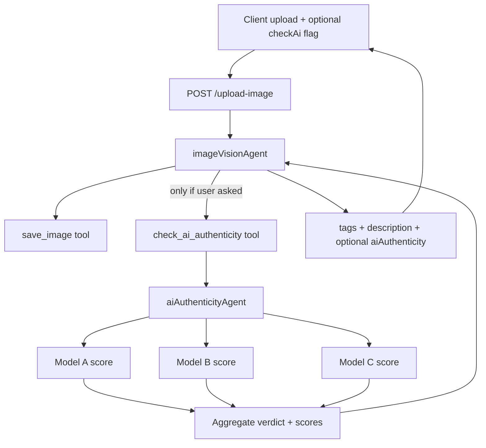

---

name: AI authenticity plan
overview: Write lab_6_1/readme.ai_analyze.md with the architecture plan and full prompts for an opt-in AI-authenticity sub-agent exposed as a tool to the main image vision agent, using 2–3 real OpenRouter vision models with scored aggregation.
todos:

- id: write-readme
content: Create lab_6_1/readme.ai_analyze.md with architecture, scoring rules, file map, API shape, acceptance criteria, and full main + authenticity prompts
status: pending
isProject: false

---

# AI authenticity agent plan → readme.ai_analyze.md

## Deliverable

Create only [`lab_6_1/readme.ai_analyze.md`](lab_6_1/readme.ai_analyze.md) — a self-contained lab design doc that includes architecture, data flow, file map, API/client contract, and the **full system/user prompts**. No application code changes in this pass.

## Chosen design (locked)

- **Opt-in from client**: authenticity runs only when the user asks (checkbox and/or text like “was this made by AI”). Default analyze path stays tags + description only.
- **Agent-as-tool**: main vision agent may call `check_ai_authenticity`; that tool wraps a dedicated authenticity agent.
- **True multi-model scoring**: authenticity agent invokes **3 OpenRouter vision models** in parallel (configurable via env), each returns `{ aiLikelihood 0–100, confidence 0–1, signals, reason }`, then aggregates to `overallAiLikelihood` + `verdict`.
- Default models (overridable in `.env`):
  - `openai/gpt-5.6-sol`
  - `deepseek/deepseek-v4.1-flash-1017`
  - `anthropic/claude-sonnet-5.5`

## Content of readme.ai_analyze.md

The file will contain these sections:

1. **Goal** — extend lab_6_1 with opt-in AI-origin detection via agent-as-tool.
2. **Architecture** — mermaid + how main agent vs authenticity agent split responsibilities.
3. **When the tool runs** — client `isAiAuthenticity` boolean and/or natural-language request; main prompt forbids calling the tool otherwise.a
4. **Multi-model scoring rules** — 0–100 scale, confidence-weighted average, verdict thresholds (`likely_real` ≤40, `inconclusive` 41–60, `likely_ai` ≥61).
5. **Proposed file map** (future implementation reference):
   - [`src/prompts/aiAuthenticityPrompt.js`](lab_6_1/src/prompts/aiAuthenticityPrompt.js) — specialist system + user prompts - create new prompt for the new agent implemented in this section
   - [`src/prompts/visionPrompt.js`](lab_6_1/src/prompts/visionPrompt.js) — update main prompt with tool gate
   - `src/agents/aiAuthenticityAgent.js` — parallel model calls + aggregate
   - `src/tools/isAiAuthenticityTool.js` — LangChain tool wrapping the agent (same pattern as [`saveImageTool.js`](lab_6_1/src/tools/saveImageTool.js))
   - `src/schemas/aiAuthenticitySchema.js` + extend [`visionResultSchema.js`](lab_6_1/src/schemas/visionResultSchema.js)
   - Wire tool in [`imageVisionAgent.js`](lab_6_1/src/agents/imageVisionAgent.js); pass flag from [`server.js`](lab_6_1/server.js) + client UI
6. **API / response shape** — extend success JSON with optional `aiAuthenticity` object.
7. **Full prompts (copy-paste ready)**:
   - **Main vision system prompt** — role, `save_image`, `check_ai_authenticity` gate, tags/description rules, optional `aiAuthenticity` in output., `check_ai_authenticity should be default false, verify its boolean`
   - **Main vision user instruction builder** — includes opt-in language only when client asks.
   - **Authenticity system prompt** — single-model assessor instructions used for each of the 3 model calls (score + confidence + signals + reason; JSON only).
   - **Authenticity aggregate prompt/rules** — how the agent combines the 3 assessments into final verdict JSON.
8. **Acceptance criteria** — no authenticity without user ask; with ask, response includes ≥2–3 model assessments + scores + verdict; existing tag/describe path still works.

## Prompt highlights to embed in the readme

**Main agent (excerpt of rules):**

- Always return tags + description.
- Call `check_ai_authenticity` at most once, and only if the client explicitly requested AI authenticity.
- Never invent authenticity scores; copy tool output into `aiAuthenticity`.

**Authenticity per-model assessor:**

- Judge AI-generated / heavily AI-edited vs real photo from pixels only.
- Return `{ model, aiLikelihood, confidence, signals[], reason }`.
- No provenance invention; inconclusive when image is too weak to judge.

**Aggregate:**

- Require 3 successful model assessments
- Confidence-weighted average → `overallAiLikelihood` + `verdict` + `summary`.

 UI 

1. Support Boolean paramter in the UI to analyze if the image created by AI or not.

## Out of scope for this pass

- Implementing agents, schemas, server
- Changing existing [`readme.md`](lab_6_1/readme.md) beyond what is documented inside `readme.ai_analyze.md`.
