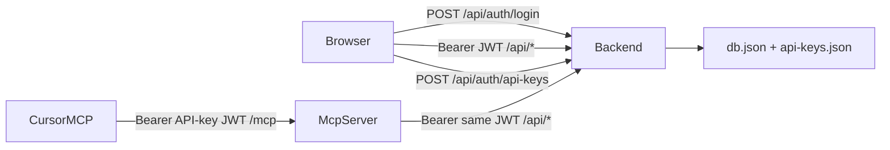

# Lab 9 — Login, Backend JWT Auth, and API Keys

**Overview:** Add backend-owned JWT auth (login + API-key minting), gate the ticket UI behind a login page, protect REST `/api` routes, and make MCP accept the same JWTs (including generated API keys) by sharing the secret and forwarding the caller token to the backend.

## Current state

- [`ui/`](../ui/) — single open ticket board; no login/router.
- [`backend/`](../backend/) — Express on `:4000`; all `/api/*` unauthenticated; data in `backend/data/db.json`.
- [`mcp-server/`](../mcp-server/) — JWT auth already lives here (`POST /auth`, `lib/auth.js` with `galamo`/`romanb`); MCP tools call backend **without** credentials.

## Target architecture

**Source of truth for credentials and JWT issuance: the backend.** MCP only verifies JWTs signed with the shared `JWT_SECRET` and forwards that Bearer token when calling the backend.

## 1. Backend auth (local, no DB)

Add [`backend/lib/auth.js`](../backend/lib/auth.js) (adapted from [`mcp-server/lib/auth.js`](../mcp-server/lib/auth.js)):

- Dummy users/roles (same as today): `galamo` → `admin`, `romanb` → `viewer`; passwords from env (`GALAMO_PASSWORD`, `ROMANB_PASSWORD`).
- `authenticate`, `signToken`, `verifyToken` (HS256).
- Login tokens: short-lived (`JWT_EXPIRES_IN`, default `1h`), claims `{ role, typ: "session" }`, `sub` = username.
- API-key tokens: long-lived (`API_KEY_EXPIRES_IN`, default `30d`), claims `{ role, typ: "api_key", jti }`, `sub` = username.

Add [`backend/lib/api-keys.js`](../backend/lib/api-keys.js) — local JSON file `backend/data/api-keys.json` (gitignored like `db.json`):

- Store metadata only: `{ id/jti, label, username, role, createdAt, expiresAt }` (never store the raw JWT after mint).
- `createApiKey({ username, role, label })` → signs JWT + appends metadata.
- `listApiKeys(username)`, `revokeApiKey(jti, username)` (revoke = drop from file; `verifyToken` rejects if `typ === "api_key"` and `jti` missing).

Wire env in backend (new `backend/.env` or shared vars): `JWT_SECRET`, `JWT_EXPIRES_IN`, `API_KEY_EXPIRES_IN`, user passwords. Add `jsonwebtoken` + `dotenv` to [`backend/package.json`](../backend/package.json).

### New/changed routes in [`backend/index.js`](../backend/index.js)

| Method   | Path                      | Auth   | Behavior                                               |
| -------- | ------------------------- | ------ | ------------------------------------------------------ |
| `POST`   | `/api/auth/login`         | public | `{ username, password }` → `{ token, role, username }` |
| `GET`    | `/api/auth/me`            | Bearer | current user from JWT                                  |
| `POST`   | `/api/auth/api-keys`      | Bearer | `{ label? }` → `{ token, ...meta }` (token shown once) |
| `GET`    | `/api/auth/api-keys`      | Bearer | list metadata for current user                         |
| `DELETE` | `/api/auth/api-keys/:jti` | Bearer | revoke                                                 |

Protect all other `/api/*` with middleware: require valid Bearer JWT; attach `req.user`.

**Role policy (mirror MCP):** `viewer` = read-only (`GET`); `admin` = full write. Return `403` on forbidden writes.

Static UI and `/health` stay public. SPA-style fallback: serve `login.html` / `api-keys.html` as static files.

## 2. UI — login gate + API keys page

Keep vanilla multipage HTML (no new frontend package).

| Page     | File                                                                 | Purpose                                                                                        |
| -------- | -------------------------------------------------------------------- | ---------------------------------------------------------------------------------------------- |
| Login    | [`ui/login.html`](../ui/login.html) + small JS                       | Form → `POST /api/auth/login` → store JWT in `localStorage` → redirect to board                |
| Board    | existing [`ui/index.html`](../ui/index.html) + [`ui/app.js`](../ui/app.js) | On load: if no/invalid token → redirect to `/login.html`; show user + Logout; link to API Keys |
| API Keys | `ui/api-keys.html` + JS                                              | Requires session JWT; generate/list/revoke; copy JWT for `.cursor/mcp.json`                    |

Update [`ui/app.js`](../ui/app.js) `api()` helper to send `Authorization: Bearer <token>` and on `401` clear storage and redirect to login.

Light CSS additions in [`ui/styles.css`](../ui/styles.css) for login + API-key pages (same look as the board).

## 3. MCP server — accept backend-issued JWTs

- Keep verifying Bearer JWTs with the **same** `JWT_SECRET` / role rules.
- Treat both `typ: "session"` and `typ: "api_key"` as valid for `/mcp` (api_key must pass local revoke check **or** rely on backend verification path — prefer verifying signature + role in MCP, and optionally call backend `/api/auth/me` only if needed; simplest: share revoke list by having MCP verify JWT claims and trust unexpired signed tokens; revocation enforced when tools hit backend which re-verifies via middleware that checks `api-keys.json`).
- Update [`mcp-server/lib/backend-client.js`](../mcp-server/lib/backend-client.js) to accept and forward `Authorization: Bearer <token>` on every backend call (thread token from MCP `authInfo`).
- Update [`create-ticket-server.js`](../mcp-server/create-ticket-server.js) tool handlers to pass the session token into `backend.*`.
- Migrate `POST /auth` on MCP: either **proxy** to backend `/api/auth/login` or remove and document backend login only. **Choice: proxy** so existing skill/tests that hit `:3300/auth` keep working, then return the backend token.
- Align [`mcp-server/lib/auth.js`](../mcp-server/lib/auth.js) with backend claims (`typ`); strip debug `console.log` noise while touching this file.
- Ensure both services load the same `JWT_SECRET` (document in README; duplicate in each `.env` for the lab).

## 4. Tests and docs

- Extend mcp-server auth tests for api-key-shaped JWTs and backend-forwarded auth failures.
- Add a small backend auth smoke test or scripted checks for login / protected route / api-key mint.
- Update [`README.md`](../README.md): login flow, env vars, API key → Cursor `mcp.json` example, remove stale `dummy-ticket-token` / stub tool notes.
- Update [`.cursor/skills/ticket-mcp-auth-refresh/SKILL.md`](../../.cursor/skills/ticket-mcp-auth-refresh/SKILL.md) to prefer generating/copying an API key from the UI (or `POST /api/auth/login` / proxied `/auth`) against the shared secret.

## Implementation order

1. Backend auth module + middleware + login/api-key routes + role gates
2. UI login gate + authenticated `api()` + API Keys page
3. MCP verify alignment + JWT forwarding to backend + `/auth` proxy
4. Tests + README + auth-refresh skill

## Defaults locked in

- Users: reuse `galamo` (admin) / `romanb` (viewer); no new user model beyond that.
- API key = long-lived JWT string (not a separate opaque key format).
- No real DB; JSON files under `backend/data/`.
- Viewer read-only on backend REST (same as MCP tool gating).
